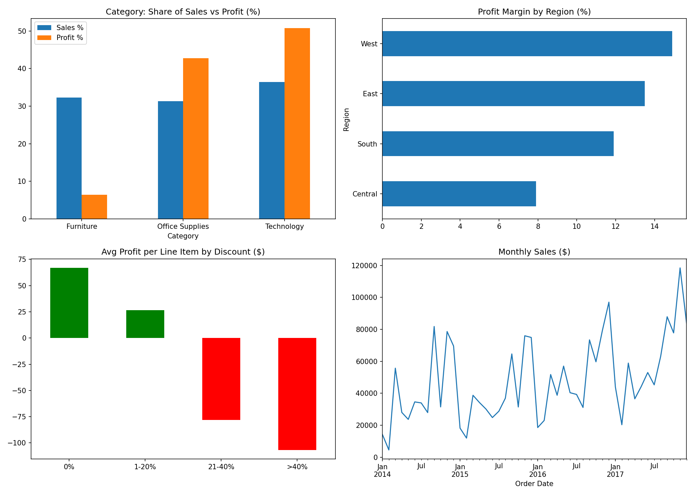

# Retail Sales Profitability Analysis

Analysis of 9,994 retail order records (Jan 2014 – Dec 2017) to find what drives profit and loss across categories, regions and discounts.

**Tools:** Python, pandas, matplotlib (Google Colab)
**Dataset:** [Superstore Dataset – Kaggle](https://www.kaggle.com/datasets/vivek468/superstore-dataset-final)

## Data cleaning
- Checked all 21 columns for missing values (none found)
- Removed 1 duplicate record (9,993 rows after cleaning)
- Converted order and ship dates from text to datetime (0 conversion errors)

## Key findings
1. **Furniture is barely profitable:** 32.3% of sales but only 6.4% of profit (2.5% margin vs ~17% for Office Supplies and Technology).
2. **Tables and Bookcases lose money:** −$17.7K and −$3.5K total profit, explaining Furniture's weak margin.
3. **Discounts above 20% make orders loss-making:** average profit per line item is +$66.9 at 0% discount, +$26.5 at 1–20%, −$78.0 at 21–40% and −$106.7 above 40%.
4. **Central region has the lowest margin:** 7.9% vs 14.9% in the West.
5. **Strong growth and seasonality:** sales grew 51.5% from 2014 ($484K) to 2017 ($733K), with a dip in 2015. September–December generated 51.6% of all sales.

## Charts

## Recommendations
- Cap discounts at 20%, especially on Furniture
- Review pricing and discounting on Tables and Bookcases
- Investigate why Central's margin is half of the West's
